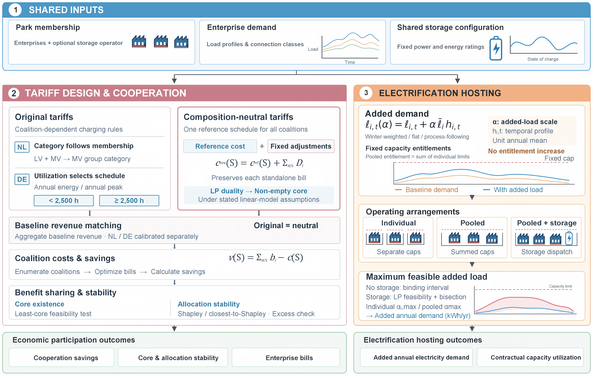

# Stable Capacity Sharing

Code for **Sustaining Cooperation in Grid Capacity Sharing: Tariff Design for Net-Zero Industrial Parks**.



Download the [VEA dataset](https://doi.org/10.5281/zenodo.13910298) and place
`master_data_tabsep.csv` and `load_profiles_tabsep.csv` in `data/vea_raw/`.

```bash
pip install -r requirements.txt
python -m nzip.data --convert
python -m scripts.run_baseline_designs --out outputs/baseline_designs.parquet
```

Other analyses are available in `scripts/`.
